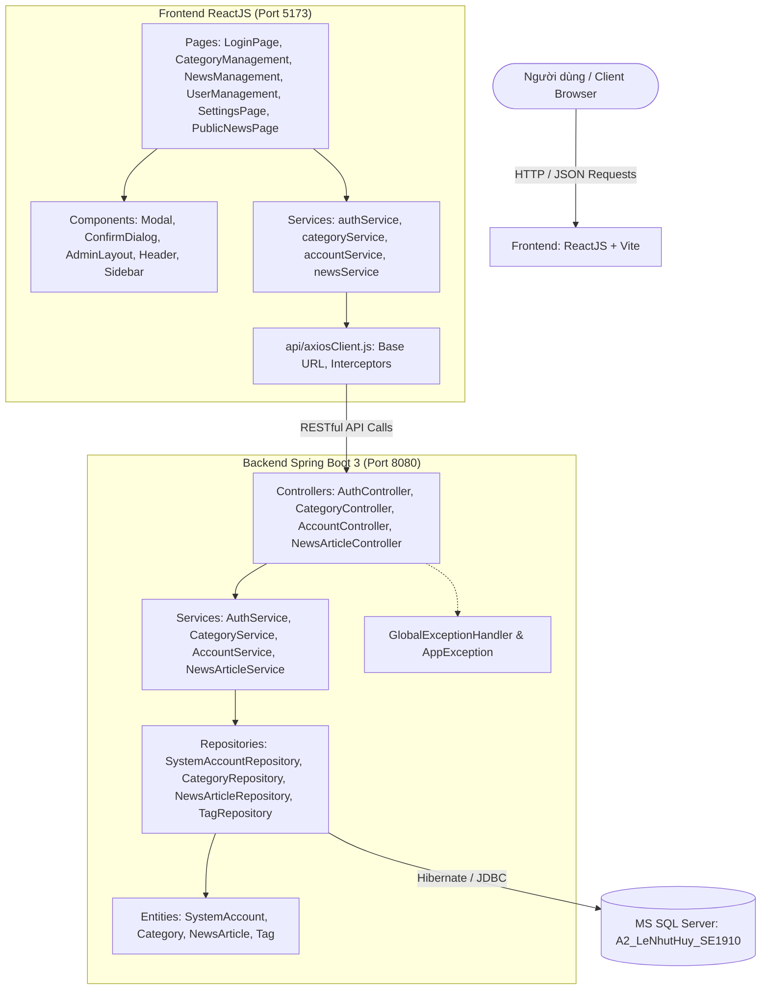
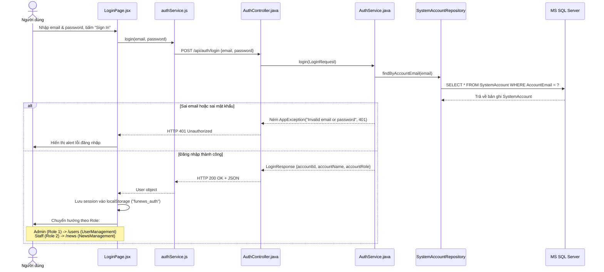
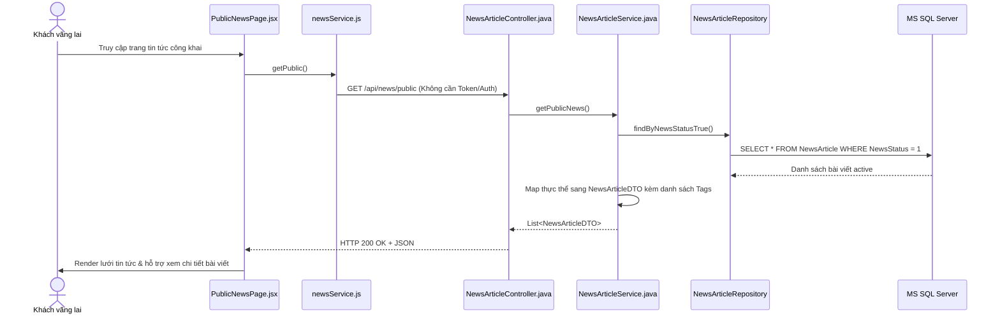
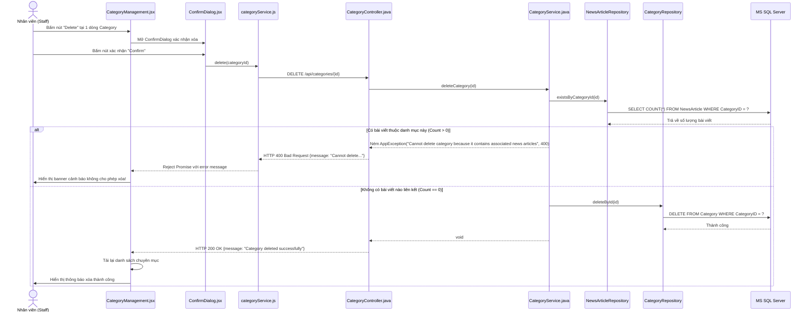
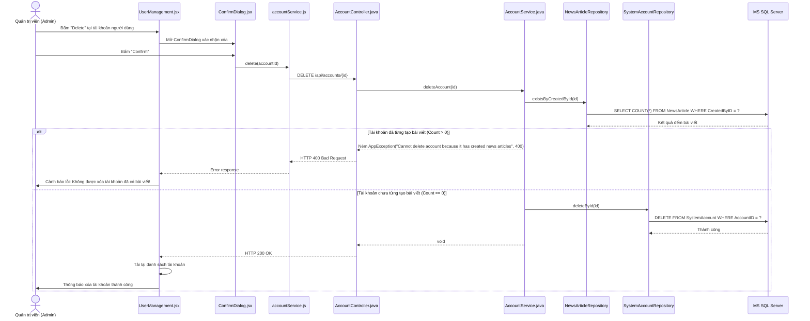
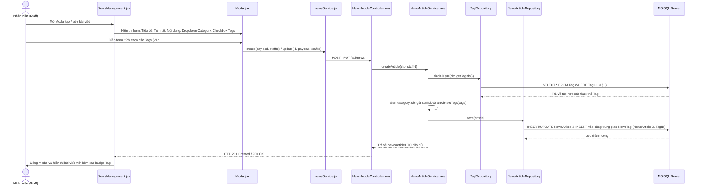

# TÀI LIỆU KIẾN TRÚC VÀ LUỒNG HOẠT ĐỘNG HỆ THỐNG
**Học phần:** SBA301 - Single Page Application with Spring Boot  
**Đề bài:** Assignment 02 - Implement CRUD Application with RESTful Web Service and ReactJS  
**Sinh viên thực hiện:** Lê Nhựt Huy - MSSV: SE1910  
**Hệ thống:** FUNewsManagementSystem  

---

## 1. Tổng quan Kiến trúc Hệ thống (System Architecture)

Hệ thống được xây dựng theo mô hình kiến trúc phân tầng chuẩn (Layered Architecture) kết hợp Single Page Application (SPA):

---

## 2. Chi tiết Tầng Backend (Spring Boot 3)

### 2.1. Cấu hình & Khởi chạy

#### `FunewsApplication.java`
- **Gói:** `com.lenhuthuy.funews`
- **Vai trò:** Lớp khởi động ứng dụng Spring Boot.
- **Hàm:**
  - `public static void main(String[] args)`: Gọi `SpringApplication.run(FunewsApplication.class, args)` để bootstrap IoC container, quét Bean và khởi động Tomcat nhúng (cổng 8080).

#### `CorsConfig.java`
- **Gói:** `com.lenhuthuy.funews.config`
- **Vai trò:** Cấu hình Cross-Origin Resource Sharing (CORS) cho phép Single Page Application ReactJS giao tiếp an toàn với backend.
- **Hàm:**
  - `corsConfigurer()`: Đăng ký `WebMvcConfigurer` cho phép origin patterns `http://localhost:*` và `http://127.0.0.1:*`, hỗ trợ các phương thức `GET`, `POST`, `PUT`, `DELETE`, `OPTIONS`, mở `allowCredentials(true)`.

---

### 2.2. Các Thực thể (JPA Entities)

| Thực thể (Entity) | Bảng CSDL | Các trường chính (Fields) | Ý nghĩa nghiệp vụ |
| :--- | :--- | :--- | :--- |
| `SystemAccount` | `SystemAccount` | `accountId` (Short, PK) `accountName` (String) `accountEmail` (String) `accountRole` (Integer) `accountPassword` (String) | Tài khoản người dùng trong hệ thống: - `accountRole = 1`: Quản trị viên (Admin) - `accountRole = 2`: Nhân viên (Staff) |
| `Category` | `Category` | `categoryId` (Short, PK, Identity) `categoryName` (String) `categoryDescription` (String) `parentCategoryId` (Short) `isActive` (Boolean) | Chuyên mục tin tức. `isActive = true` là đang hoạt động. |
| `Tag` | `Tag` | `tagId` (Integer, PK) `tagName` (String) `note` (String) | Thẻ gắn vào bài viết để phân loại từ khóa. |
| `NewsArticle` | `NewsArticle` | `newsArticleId` (String, PK) `newsTitle` (String) `headline` (String) `createdDate` (LocalDateTime) `newsContent` (String) `newsSource` (String) `category` (Category, @ManyToOne) `newsStatus` (Boolean) `createdBy` (SystemAccount, @ManyToOne) `updatedById` (Short) `modifiedDate` (LocalDateTime) `tags` (Set&lt;Tag&gt;, @ManyToMany qua bảng `NewsTag`) | Bài viết tin tức. - `newsStatus = true`: Tin đã duyệt/công khai. - Liên kết 1 chuyên mục (`CategoryID`). - Liên kết người tạo (`CreatedByID`). - Quan hệ n-n với `Tag` qua bảng `NewsTag`. |

---

### 2.3. Tầng Truy xuất Dữ liệu (Repositories)

#### `SystemAccountRepository.java`
- `findByAccountEmail(String email)`: Tìm kiếm tài khoản theo email (dùng khi xác thực đăng nhập).
- `existsByAccountEmail(String email)`: Kiểm tra email đã được đăng ký hay chưa khi tạo mới/cập nhật tài khoản.
- `findByAccountNameContainingIgnoreCaseOrAccountEmailContainingIgnoreCase(String name, String email)`: Tìm kiếm tài khoản theo tên hoặc email.
- `findMaxAccountId()`: Lấy mã ID tài khoản lớn nhất trong database để tự động cấp phát ID kế tiếp.

#### `CategoryRepository.java`
- `findByCategoryNameContainingIgnoreCase(String name)`: Tìm kiếm chuyên mục theo từ khóa tên (không phân biệt hoa thường).

#### `NewsArticleRepository.java`
- `existsByCategoryId(Short categoryId)`: **Ràng buộc nghiệp vụ quan trọng**: Kiểm tra xem có bài viết nào đang thuộc về chuyên mục này không (dùng để chặn thao tác xóa category).
- `existsByCreatedById(Short accountId)`: **Ràng buộc nghiệp vụ quan trọng**: Kiểm tra xem tài khoản này đã từng đăng bài viết nào chưa (dùng để chặn thao tác xóa account của Admin).
- `findByNewsStatusTrue()`: Lấy toàn bộ bài viết đang active (`newsStatus = true`) phục vụ cho khách vãng lai.
- `findByCreatedBy_AccountId(Short accountId)`: Lấy danh sách bài viết do chính nhân viên chỉ định tạo ra (lịch sử bài viết).
- `searchByKeyword(String keyword)`: Tìm kiếm bài viết theo tiêu đề (`newsTitle`) hoặc nội dung (`newsContent`).

#### `TagRepository.java`
- `findAll()`: Trả về danh sách tất cả các tag để giao diện React hiển thị danh sách checkbox khi biên tập bài viết.

---

### 2.4. Tầng Dịch vụ (Service Layer)

#### `AuthService.java`
- `login(LoginRequest request)`:
  - Nhận `email` và `password`.
  - Tìm `SystemAccount` bằng `findByAccountEmail`. Nếu không thấy, ném `AppException("Invalid email or password", HttpStatus.UNAUTHORIZED)`.
  - So khớp mật khẩu: Nếu sai, ném ngoại lệ 401.
  - Trả về `LoginResponse` chứa `accountId`, `accountName`, `accountEmail`, `accountRole`.

#### `CategoryService.java`
- `getAllCategories(String search)`: Lọc theo tên nếu có `search`, ngược lại lấy tất cả.
- `getCategoryById(Short id)`: Trả về chi tiết chuyên mục hoặc ném 404.
- `createCategory(CategoryDTO dto)`: Lưu chuyên mục mới, mặc định trạng thái `isActive = true`.
- `updateCategory(Short id, CategoryDTO dto)`: Cập nhật thông tin chuyên mục theo ID.
- `deleteCategory(Short id)`:
  - Kiểm tra tồn tại qua `existsById(id)`.
  - **Kiểm tra ràng buộc:** `newsArticleRepository.existsByCategoryId(id)`. Nếu trả về `true` $\rightarrow$ ném `AppException("Cannot delete category because it contains associated news articles", HttpStatus.BAD_REQUEST)`.
  - Nếu không có bài viết liên kết, thực hiện xóa bằng `deleteById(id)`.

#### `AccountService.java`
- `getAllAccounts(String search)`: Lấy danh sách tài khoản, có hỗ trợ tìm kiếm theo tên hoặc email.
- `getAccountById(Short id)`: Lấy thông tin tài khoản theo ID.
- `createAccount(AccountDTO dto)`: Kiểm tra trùng email, tự động gán `accountId` mới bằng `maxId + 1`, mã hóa/lưu mật khẩu.
- `updateAccount(Short id, AccountDTO dto)`: Cập nhật thông tin tài khoản, kiểm tra trùng email nếu đổi sang email khác.
- `deleteAccount(Short id)`:
  - Kiểm tra tồn tại.
  - **Kiểm tra ràng buộc:** `newsArticleRepository.existsByCreatedById(id)`. Nếu tài khoản này đã từng tạo bài viết $\rightarrow$ ném `AppException("Cannot delete account because it has created news articles", HttpStatus.BAD_REQUEST)`.
  - Nếu hợp lệ, thực thi xóa qua `deleteById(id)`.

#### `NewsArticleService.java`
- `getPublicNews()`: Trả về danh sách bài viết đang active (`newsStatus = true`) cho khách vãng lai, chuyển đổi sang `NewsArticleDTO` kèm danh sách tag.
- `getAllArticles(String search, Short categoryId, Boolean status)`: Tìm kiếm đa tiêu chí (theo từ khóa, chuyên mục, trạng thái) dành cho Staff.
- `getStaffHistory(Short staffId)`: Lấy danh sách bài viết do `staffId` tạo ra.
- `createArticle(NewsArticleDTO dto, Short staffId)`:
  - Sinh mã `newsArticleId` tự động.
  - Tìm và gán `Category`.
  - Gán `createdBy` là tài khoản của Staff đang thực hiện.
  - Lấy các thực thể `Tag` từ CSDL dựa trên mảng `tagIds` và gắn vào thực thể bài viết.
  - Lưu vào CSDL (bảng `NewsArticle` và bảng liên kết `NewsTag`).
- `updateArticle(String id, NewsArticleDTO dto, Short staffId)`:
  - Cập nhật tiêu đề, tóm tắt, nội dung, nguồn, chuyên mục, trạng thái.
  - Đồng bộ danh sách `Tag` mới vào quan hệ `@ManyToMany`.
  - Cập nhật `updatedById = staffId` và `modifiedDate = now()`.
- `deleteArticle(String id)`: Xóa bài viết khỏi hệ thống (tự động xóa liên kết tag trong `NewsTag`).
- `getAllTags()`: Lấy danh sách tất cả các tag có sẵn.

---

### 2.5. Tầng Điều khiển REST API (Controllers)

| Controller | Phương thức & URL | Hàm xử lý | Dịch vụ gọi tới |
| :--- | :--- | :--- | :--- |
| `AuthController` | `POST /api/auth/login` | `login(@Valid @RequestBody LoginRequest)` | `authService.login(...)` |
| `CategoryController` | `GET /api/categories` | `getAllCategories(@RequestParam search)` | `categoryService.getAllCategories(...)` |
| | `GET /api/categories/{id}` | `getCategoryById(@PathVariable id)` | `categoryService.getCategoryById(...)` |
| | `POST /api/categories` | `createCategory(@Valid @RequestBody dto)` | `categoryService.createCategory(...)` |
| | `PUT /api/categories/{id}` | `updateCategory(@PathVariable id, dto)` | `categoryService.updateCategory(...)` |
| | `DELETE /api/categories/{id}` | `deleteCategory(@PathVariable id)` | `categoryService.deleteCategory(...)` |
| `AccountController` | `GET /api/accounts` | `getAllAccounts(@RequestParam search)` | `accountService.getAllAccounts(...)` |
| | `GET /api/accounts/{id}` | `getAccountById(@PathVariable id)` | `accountService.getAccountById(...)` |
| | `POST /api/accounts` | `createAccount(@Valid @RequestBody dto)` | `accountService.createAccount(...)` |
| | `PUT /api/accounts/{id}` | `updateAccount(@PathVariable id, dto)` | `accountService.updateAccount(...)` |
| | `DELETE /api/accounts/{id}` | `deleteAccount(@PathVariable id)` | `accountService.deleteAccount(...)` |
| `NewsArticleController`| `GET /api/news/public` | `getPublicNews()` | `newsArticleService.getPublicNews()` |
| | `GET /api/news` | `getAllArticles(search, categoryId, status)` | `newsArticleService.getAllArticles(...)` |
| | `GET /api/news/my-history` | `getStaffHistory(@RequestParam staffId)` | `newsArticleService.getStaffHistory(...)` |
| | `GET /api/news/{id}` | `getArticleById(@PathVariable id)` | `newsArticleService.getArticleById(...)` |
| | `POST /api/news` | `createArticle(dto, staffId)` | `newsArticleService.createArticle(...)` |
| | `PUT /api/news/{id}` | `updateArticle(id, dto, staffId)` | `newsArticleService.updateArticle(...)` |
| | `DELETE /api/news/{id}` | `deleteArticle(@PathVariable id)` | `newsArticleService.deleteArticle(...)` |
| | `GET /api/tags` | `getAllTags()` | `newsArticleService.getAllTags()` |

---

## 3. Chi tiết Tầng Frontend (ReactJS Client)

### 3.1. Cấu hình Axios & Các Module Service

#### `src/api/axiosClient.js`
- **Biến `axiosClient`**: Đối tượng Axios tạo bởi `axios.create({ baseURL: "http://localhost:8080/api" })`.
- **Response Interceptor:** Trích xuất trực tiếp `response.data`. Nếu gặp mã lỗi (400, 401, 404, 500), tự động lấy `error.response?.data?.message` và đóng gói vào `Promise.reject(new Error(message))` để các component dễ dàng hiển thị thông báo.

#### `src/services/`
- **`authService.js`**: `login(email, password)` $\rightarrow$ gọi `POST /api/auth/login`.
- **`categoryService.js`**: `getAll(search)`, `getById(id)`, `create(data)`, `update(id, data)`, `delete(id)`.
- **`accountService.js`**: `getAll(search)`, `getById(id)`, `create(data)`, `update(id, data)`, `delete(id)`.
- **`newsService.js`**: `getPublic()`, `getAll(search, categoryId, status)`, `getHistory(staffId)`, `create(data, staffId)`, `update(id, data, staffId)`, `delete(id)`, `getTags()`.

---

### 3.2. Cấu trúc Quản lý Trạng thái & Giao diện (Pages & Components)

#### `src/App.jsx`
- **State chính:**
  - `currentUser`: Lưu thông tin phiên đăng nhập (`accountId`, `accountName`, `accountRole`), khởi tạo từ `localStorage.getItem("funews_auth")`.
  - `activeMenu`: Menu hiện tại được kích hoạt (`"news"`, `"category"`, `"users"`, `"settings"`).
  - `isGuestMode`: Cờ boolean đánh dấu người dùng có đang ở chế độ duyệt tin công khai dành cho khách vãng lai hay không.
- **Hàm:**
  - `handleLogin(user)`: Cập nhật `currentUser`, tắt `isGuestMode`, tự động điều hướng:
    - Nếu `accountRole === 1` (Admin) $\rightarrow$ kích hoạt menu `"users"`.
    - Nếu `accountRole === 2` (Staff) $\rightarrow$ kích hoạt menu `"news"`.
  - `handleLogout()`: Xóa `funews_auth` khỏi `localStorage`, đặt `currentUser = null`.

#### `src/pages/LoginPage.jsx`
- **State:** `email`, `password`, `error`, `loading`.
- **Hàm:**
  - `handleSubmit(e)`: Kiểm tra dữ liệu hợp lệ $\rightarrow$ gọi `authService.login(email, password)` $\rightarrow$ nhận thông tin tài khoản $\rightarrow$ lưu vào `localStorage` $\rightarrow$ gọi callback `onLogin(user)`.
  - Nút **"Browse Public News (Guest Mode)"**: Gọi callback `onGuestView` để xem tin tức mà không cần đăng nhập.

#### `src/pages/PublicNewsPage.jsx`
- **State:** `articles` (danh sách tin active), `loading`, `error`, `selectedArticle` (bài viết được chọn để đọc chi tiết trên Modal).
- **Hàm:**
  - `fetchPublicNews()`: Gọi `newsService.getPublic()`, nhận danh sách tin `NewsStatus = 1`.
  - `setSelectedArticle(item)`: Mở Modal hiển thị toàn văn nội dung tin bài, chuyên mục, tác giả, ngày đăng và danh sách thẻ tags.

#### `src/pages/CategoryManagement.jsx`
- **State:** `categories` (danh sách chuyên mục), `searchTerm` (từ khóa tìm kiếm), `loading`, `errorMessage`, `successMessage`, `isModalOpen`, `modalMode` (`"create"` hoặc `"update"`), `selectedCategory`, `formData` (`name`, `description`, `status`), `deleteTarget`, `isConfirmOpen`.
- **Hàm:**
  - `fetchCategories(keyword)`: Gọi `categoryService.getAll(keyword)`.
  - `handleOpenCreate()` / `handleOpenEdit(cat)`: Khởi tạo form và mở Modal.
  - `handleFormSubmit(e)`: Kiểm tra trường bắt buộc $\rightarrow$ gọi `categoryService.create` hoặc `categoryService.update` $\rightarrow$ đóng Modal $\rightarrow$ làm mới danh sách.
  - `handleOpenDelete(cat)`: Gán `deleteTarget` và mở ConfirmDialog.
  - `handleConfirmDelete()`:
    - Gửi yêu cầu `categoryService.delete(deleteTarget.categoryId)`.
    - **Bắt ngoại lệ nghiệp vụ:** Nếu CSDL đang có bài viết thuộc danh mục này, backend trả lỗi 400 kèm message: `"Cannot delete category because it contains associated news articles"`. Hàm `catch` sẽ hiển thị thông báo lỗi nổi bật trên giao diện mà không làm crash ứng dụng.

#### `src/pages/UserManagement.jsx`
- **State:** `users`, `searchTerm`, `formData` (`name`, `email`, `password`, `role`), `selectedUser`, `deleteTarget`, `isConfirmOpen`, `errorMessage`, `successMessage`.
- **Hàm:**
  - `fetchUsers(keyword)`: Gọi `accountService.getAll(keyword)`.
  - `handleFormSubmit(e)`: Tạo mới hoặc cập nhật tài khoản qua `accountService`.
  - `handleConfirmDelete()`:
    - Gọi `accountService.delete(deleteTarget.accountId)`.
    - **Bắt ngoại lệ nghiệp vụ:** Nếu tài khoản này đã từng tạo bài viết (`CreatedByID`), backend trả lỗi 400 kèm message: `"Cannot delete account because it has created news articles"`. Giao diện lập tức bắt lỗi và hiển thị popup cảnh báo.
    - Ngăn chặn người dùng tự xóa tài khoản của chính mình đang đăng nhập (`disabled` nút Delete).

#### `src/pages/NewsManagement.jsx`
- **State:** `news` (danh sách bài viết), `categories`, `availableTags`, `searchTerm`, `filterCategory`, `filterStatus`, `formData` (`title`, `headline`, `content`, `source`, `categoryId`, `status`, `tagIds`), `deleteTarget`, `isConfirmOpen`.
- **Hàm:**
  - `loadData()`: Sử dụng `Promise.all` nạp song song: danh sách bài viết (`newsService.getAll`), chuyên mục (`categoryService.getAll`), và danh sách thẻ tags (`newsService.getTags`).
  - `handleTagToggle(tagId)`: Cập nhật mảng `tagIds` khi người dùng tích/bỏ tích checkbox tags trong Modal.
  - `handleFormSubmit(e)`: Đóng gói dữ liệu bài viết kèm danh sách `tagIds` $\rightarrow$ gọi `newsService.create` hoặc `newsService.update`.
  - `handleConfirmDelete()`: Xác nhận và xóa bài viết qua `newsService.delete(id)`.

#### `src/pages/SettingsPage.jsx`
- **State:** `profileName`, `profileEmail`, `newPassword`, `myHistory` (danh sách bài viết do Staff đăng nhập sáng tác), `loadingHistory`, `saving`.
- **Hàm:**
  - `handleUpdateProfile(e)`: Cập nhật họ tên, mật khẩu của tài khoản hiện tại qua `accountService.update`.
  - `loadMyHistory()`: Gọi `newsService.getHistory(currentUser.accountId)` để lấy chính xác các bài viết có `CreatedByID` trùng khớp với Staff đang đăng nhập.

---

## 4. Chi tiết Luồng Dữ liệu Hoạt động (Sequence / Data Flow)

### 4.1. Luồng Xác thực Đăng nhập & Điều hướng Phân quyền (Authentication Flow)

---

### 4.2. Luồng Khách vãng lai xem Tin tức công khai (Public News Flow)

---

### 4.3. Luồng Xóa Danh mục & Kiểm tra Ràng buộc Dữ liệu (Category Delete Flow)

---

### 4.4. Luồng Xóa Tài khoản Quản trị & Ràng buộc Toàn vẹn (Account Delete Flow)

---

### 4.5. Luồng Tạo / Sửa Bài viết gắn danh sách Tags (News Article & Many-to-Many Tags)

---

## 5. Ma trận Ánh xạ Thành phần (End-to-End Component Matrix)

| Chức năng | Giao diện React (View/Modal) | Service Frontend | Endpoint API | Controller & Service Backend | Repository & Database |
| :--- | :--- | :--- | :--- | :--- | :--- |
| **Đăng nhập** | `LoginPage.jsx` | `authService.login` | `POST /api/auth/login` | `AuthController` $\rightarrow$ `AuthService.login` | `SystemAccountRepository` $\rightarrow$ `SystemAccount` |
| **Xem tin vãng lai** | `PublicNewsPage.jsx` | `newsService.getPublic` | `GET /api/news/public` | `NewsArticleController` $\rightarrow$ `NewsArticleService.getPublicNews` | `NewsArticleRepository` $\rightarrow$ `NewsArticle` (`Status=1`) |
| **Xem / Tìm kiếm Category** | `CategoryManagement.jsx` | `categoryService.getAll` | `GET /api/categories` | `CategoryController` $\rightarrow$ `CategoryService.getAllCategories` | `CategoryRepository` $\rightarrow$ `Category` |
| **Thêm / Sửa Category** | `Modal.jsx` (trong `CategoryManagement`) | `categoryService.create` `categoryService.update` | `POST /api/categories` `PUT /api/categories/{id}` | `CategoryController` $\rightarrow$ `CategoryService.createCategory` | `CategoryRepository` $\rightarrow$ `Category` |
| **Xóa Category (Có check)** | `ConfirmDialog.jsx` (trong `CategoryManagement`) | `categoryService.delete` | `DELETE /api/categories/{id}` | `CategoryController` $\rightarrow$ `CategoryService.deleteCategory` | `NewsArticleRepository` (check) `CategoryRepository` (delete) |
| **Xem / Tìm kiếm Account** | `UserManagement.jsx` | `accountService.getAll` | `GET /api/accounts` | `AccountController` $\rightarrow$ `AccountService.getAllAccounts` | `SystemAccountRepository` $\rightarrow$ `SystemAccount` |
| **Thêm / Sửa Account** | `Modal.jsx` (trong `UserManagement`) | `accountService.create` `accountService.update` | `POST /api/accounts` `PUT /api/accounts/{id}` | `AccountController` $\rightarrow$ `AccountService.createAccount` | `SystemAccountRepository` $\rightarrow$ `SystemAccount` |
| **Xóa Account (Có check)** | `ConfirmDialog.jsx` (trong `UserManagement`) | `accountService.delete` | `DELETE /api/accounts/{id}` | `AccountController` $\rightarrow$ `AccountService.deleteAccount` | `NewsArticleRepository` (check) `SystemAccountRepository` (delete) |
| **Quản lý News & Tags** | `NewsManagement.jsx` | `newsService.getAll` `newsService.create` `newsService.update` `newsService.delete` | `GET /api/news` `POST /api/news` `PUT /api/news/{id}` `DELETE /api/news/{id}` | `NewsArticleController` $\rightarrow$ `NewsArticleService` | `NewsArticleRepository` `TagRepository` $\rightarrow$ `NewsArticle`, `NewsTag`, `Tag` |
| **Cập nhật Profile Staff** | `SettingsPage.jsx` | `accountService.update` | `PUT /api/accounts/{id}` | `AccountController` $\rightarrow$ `AccountService.updateAccount` | `SystemAccountRepository` |
| **Xem Lịch sử bài viết Staff**| `SettingsPage.jsx` | `newsService.getHistory` | `GET /api/news/my-history` | `NewsArticleController` $\rightarrow$ `NewsArticleService.getStaffHistory` | `NewsArticleRepository` (`CreatedByID`) |

---

## 6. Tổng kết
Tài liệu trên mô tả đầy đủ toàn bộ vòng đời của dữ liệu từ thao tác click của người dùng trên giao diện ReactJS, đi qua mạng lưới Axios REST client, được điều hướng qua Spring Controller, thẩm định nghiệp vụ tại tầng Service, truy vấn an toàn tại Repository với JPA/Hibernate, và kiểm soát ràng buộc toàn vẹn khóa ngoại trên hệ cơ sở dữ liệu quan hệ Microsoft SQL Server.

